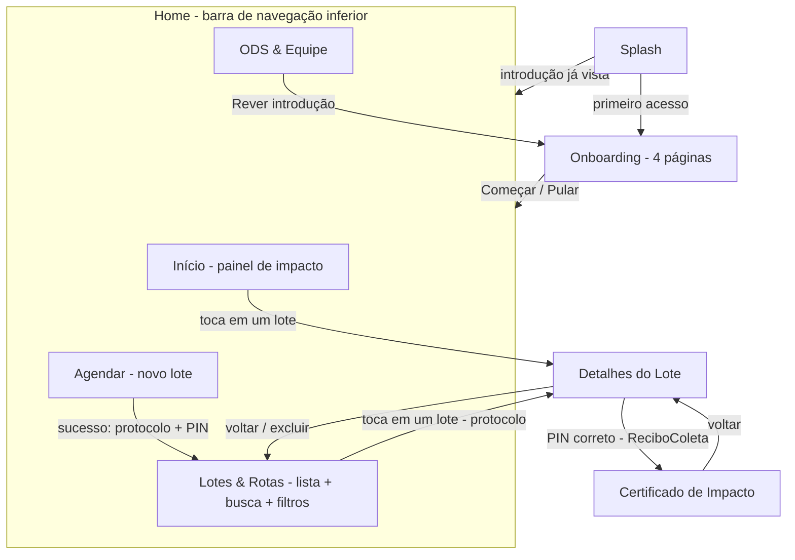

#  ColetaAgendada — App Mobile (Flutter)

> **Global Solution 2026 • CitizenTech** — Aplicativo mobile que conecta condomínios e comércios geradores de recicláveis limpos a coletores autônomos e cooperativas, com agendamento de lotes, reserva exclusiva de rota e validação da retirada por PIN de 4 dígitos.

---

##  Desenvolvedores

| Felipe Boveri | 555055 |
| Clara de Fonte | 554321 |

---

##  Tema da Global Solution

**CitizenTech — tecnologia para impacto social e ambiental urbano.**

Pequenos comércios e condomínios acumulam diariamente papelão, plástico, latas e vidro limpos. Como a coleta pública tem horários rígidos, o material ocupa espaço ou vai parar na calçada. Do outro lado, coletores caminham quilômetros sem saber onde há material disponível e perdem viagens.

**ODS atendidos (Agenda 2030 da ONU)**
- **ODS 10 — Redução das desigualdades:** renda e previsibilidade de rota para coletores.
- **ODS 11 — Cidades e comunidades sustentáveis:** menos resíduos nas calçadas, logística reversa organizada.
- **ODS 13 — Ação contra a mudança global do clima:** mais reciclagem efetiva e contabilização do CO₂ evitado.

---

##  Descrição da solução

| Perfil | O que faz no app |
| --- | --- |
| **Ponto gerador** (síndico / comerciante) | Agenda um lote informando CNPJ, contato, CEP (endereço preenchido via **ViaCEP**), material, peso e janela de retirada. Recebe **protocolo** e **PIN de 4 dígitos**. |
| **Coletor / cooperativa** | Busca lotes por CEP, local ou material; **reserva** o lote (ele sai do radar dos demais); na retirada digita o **PIN** da portaria e recebe o **certificado de impacto**. |

**Regras de negócio implementadas** (`lib/services/lote_service.dart`)
1. Somente CNPJs cadastrados e **ATIVOS** podem publicar lotes.
2. **Trava logística:** lotes abaixo de **10 kg** são bloqueados.
3. Endereço padronizado pelo **CEP** via API ViaCEP.
4. Todo lote válido recebe status `DISPONIVEL`, protocolo único e PIN aleatório de 4 dígitos.
5. Ciclo de vida: `DISPONIVEL → RESERVADO → COLETADO` (só com PIN correto).
6. Impacto: **CO₂ evitado = peso × 1,5** • **Receita = peso × cotação** (Papelão R$ 0,80 • Plástico R$ 1,50 • Alumínio R$ 6,00 • Vidro R$ 0,40 por kg).
7. Privacidade: o telefone da portaria só é exibido após a reserva.

---

##  Fluxo de telas



| Tela | Descrição |
| --- | --- |
| **Splash** | Logo (`Image.asset`), transição automática; lê o `SharedPreferences` e direciona para Onboarding ou Home. |
| **Onboarding** | 4 páginas com ícone, título e descrição; botões **Voltar/Avançar**, **Pular** e a opção **"Não mostrar novamente"** (salva no `SharedPreferences` somente se marcada). |
| **Início** | Impacto coletivo (kg reciclados, CO₂ evitado, ganho estimado), situação dos lotes, ODS e lotes disponíveis. Puxe para atualizar. |
| **Agendar** | Formulário com máscaras, busca de CEP no **ViaCEP** (estados inicial / carregando / sucesso / erro + tentar novamente), escolha de material e janela, trava de 10 kg com prévia do impacto e diálogo com protocolo + PIN. |
| **Lotes & Rotas** | `ListView` de cards, busca por CEP/local/material, filtros (Todos, Disponíveis, Reservados, Coletados, Favoritos) e favoritar. |
| **Detalhes do Lote** | Recebe o **protocolo** por parâmetro. Endereço via ViaCEP, impacto, reservar / cancelar reserva, validar PIN, favoritar e excluir. |
| **Certificado de Impacto** | Recebe um objeto **`ReciboColeta`** por parâmetro com peso, CO₂ evitado e ganho. |
| **ODS & Equipe** | Equipe, ODS, diferenciais, API utilizada e configurações (rever introdução, restaurar dados). |

---

##  Prints das telas


---

##  API utilizada

**ViaCEP** — API REST pública de consulta de CEP, consumida com o pacote [`http`](https://pub.dev/packages/http).

```
GET https://viacep.com.br/ws/{cep}/json/
```

Exemplo de resposta convertida no model `Endereco` (`lib/models/endereco.dart`):

```json
{
  "cep": "01310-100",
  "logradouro": "Avenida Paulista",
  "complemento": "de 612 a 1510 - lado par",
  "bairro": "Bela Vista",
  "localidade": "São Paulo",
  "uf": "SP"
}
```

Tratamento em `lib/services/viacep_service.dart`:
- CEP inexistente (`{"erro": true}`), formato inválido (HTTP 400), outros status HTTP, timeout de 10 s e falta de conexão viram uma `ViaCepException` com mensagem amigável.
- A interface (`EnderecoViaCepCard`) mostra os estados **inicial**, **carregamento**, **sucesso** e **erro** com botão **"Tentar novamente"**.
- Usada em dois lugares: no formulário de agendamento e na tela de detalhes do lote.

> No projeto completo da Global Solution, os dados de geradores e lotes vêm do back-end Java/Oracle (`/api/geradores`, `/api/lotes`). No app mobile essa camada fica nos **repositories** com persistência local, de modo que trocar para a API Java exige alterar apenas os repositories.

---

##  Arquitetura

Separação em camadas: **interface → serviços (regras de negócio) → repositórios (dados) → models**.

```
lib/
├── main.dart                     # ponto de entrada
├── app.dart                      # MaterialApp, tema e rotas nomeadas (onGenerateRoute)
├── core/
│   ├── routes/app_routes.dart    # nomes das rotas
│   ├── theme/                    # AppColors + AppTheme (Material 3)
│   └── utils/                    # Formatters, máscara de input, ViewState
├── models/                       # Lote, Gerador, Endereco, ReciboColeta, ImpactoResumo,
│                                 # MaterialReciclavel, StatusLote, Ods, OnboardingItem, Integrante
├── repositories/                 # LoteRepository (SharedPreferences/JSON), GeradorRepository
├── services/                     # LoteService (regras), ViaCepService (http), PreferencesService
├── screens/                      # Splash, Onboarding, HomeShell, Início, Agendar, Lotes,
│                                 # LoteDetalhe, Recibo, Sobre (ODS & Equipe)
└── widgets/                      # componentes reutilizáveis
```

| Camada | Responsabilidade |
| --- | --- |
| **models** | Classes imutáveis com `fromJson`/`toJson` e propriedades calculadas (`co2Evitado`, `receitaEstimada`). |
| **repositories** | Acesso aos dados: lotes persistidos em JSON no `SharedPreferences`; geradores homologados. |
| **services** | Regras de negócio (validação de CNPJ ativo, piso de 10 kg, geração de protocolo/PIN, transições de status, cálculo de impacto, filtros), consumo do ViaCEP e preferências. |
| **screens** | Apenas interface e estado da tela com `setState`; chamam os serviços e exibem o resultado. |
| **widgets** | Componentes reutilizados entre telas. |

**Gerenciamento de estado:** `StatefulWidget` + `setState` nas telas que mudam (Splash, Onboarding, HomeShell, Início, Agendar, Lotes, Detalhes); `StatelessWidget` nas telas e componentes somente de exibição (Recibo, ODS & Equipe e todos os widgets).

**Navegação:** rotas nomeadas com `onGenerateRoute`, `pushReplacementNamed` (Splash/Onboarding), `pushNamed` com argumentos (`int protocolo` e `ReciboColeta`), `pop` com retorno e `PopScope` para que o botão voltar do Android retorne à aba Início antes de sair.

**Widgets reutilizáveis** (`lib/widgets/`): `AppLogo`, `SectionCard`, `StatCard`, `StatusBadge`, `LoteCard`, `ImpactoMaterialBox`, `InfoRow`, `PageHeaderBanner`, `AlertBanner`, `EnderecoViaCepCard`, `PinBox`, `OdsTile`/`OdsChip`/`OdsNumero`, `OnboardingPage`, `LoadingView`, `ErrorView`, `EmptyView`.

**Interações implementadas:** abrir detalhes ao tocar no lote • busca por texto • filtros por status • favoritar • reservar / cancelar reserva • validar PIN • excluir com confirmação • mostrar/ocultar PIN • puxar para atualizar • escolher gerador homologado • prévia do impacto em tempo real.

---

##  Como executar

Pré-requisitos: Flutter 3.41+ (Dart 3.11+) e um emulador Android ou dispositivo.

```bash
flutter pub get
flutter run
```

Testes das regras de negócio (casos CT01 a CT05 do documento do projeto):

```bash
flutter test
```

### Dados para demonstração

| CNPJ | Local | Situação |
| --- | --- | --- |
| 12.345.678/0001-90 | Condomínio Grand Plaza | ATIVO |
| 98.765.432/0001-11 | Mercado da Vila | ATIVO |
| 11.222.333/0001-44 | Condomínio Edifício Paulista | ATIVO |
| 44.555.666/0001-77 | Padaria Pão Dourado | ATIVO |
| 55.666.777/0001-88 | Restaurante Parque Verde | ATIVO |
| 99.888.777/0001-66 | Loja Centro | **INATIVO** (testa o bloqueio) |

No formulário, o botão **"Homologados"** preenche os dados automaticamente.
O lote **#1002 (Mercado da Vila)** já começa **RESERVADO** com PIN **`1234`** (teste do CT04/CT05).
Em **ODS & Equipe → Restaurar dados de demonstração** a massa inicial volta.

---

##  Dependências

| Pacote | Uso |
| --- | --- |
| `http` | Requisições REST ao ViaCEP |
| `shared_preferences` | Preferência da introdução, lotes e favoritos |
